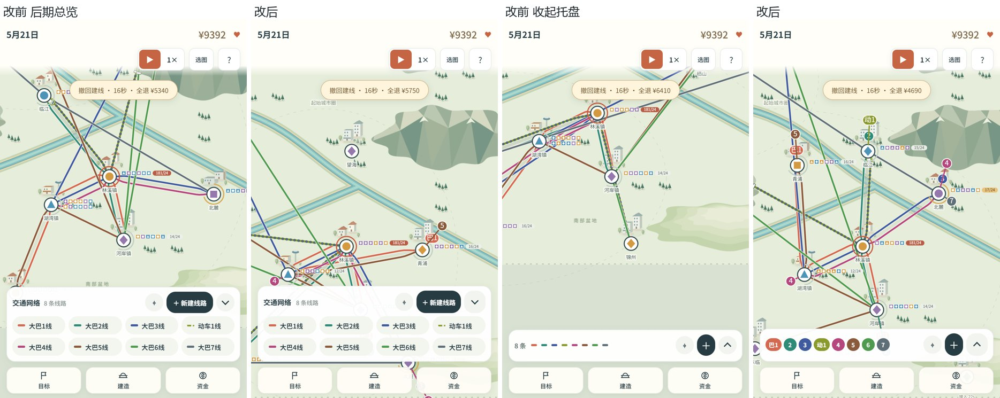
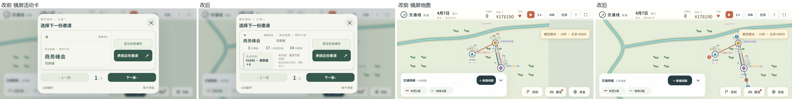

## 范围

基于上游 v1.4 `57d1284`，提交本轮已验收的体验层整理，以及后续审计发现的镜头、通知、颜色持久化和线路提交修复。保留 v1.4 成就、西部盆地和单击选线编辑；不修改经济数值、存档键或历史入口，不包含网站部署和 APK 构建。

### 已验收的界面整理

- 交通网络托盘支持完整显示后期多线路，收起后按编号/颜色直接选线；线路端点与托盘编号对应。
- 后期地图减少候车与任务信息堆叠；城市详情优先显示候车负荷，共线城市先选择线路或查看城市。
- 中心页框架与页签稳定，修正横屏活动卡裁切、次要页面空状态和帮助说明；成就页保留一个吸顶关闭入口。
- 保持上游当前地图方向；改进包含竖屏、横屏和桌面，并非仅竖屏样式变化。

### 逻辑修复

- **镜头恢复**：关闭最后一个详情/选线面板后按会话恢复视图，避免软边界回推被当作玩家手动移动；玩家主动平移/缩放后不强制拉回，开始拉线不跳镜头。
- **颜色预览**：预览不写入游戏状态，取消、关闭和未保存刷新均保留原色；只有保存设置才持久化。
- **通知生命周期**：只为后写入的活动与城市倒计时管理关闭状态，绑定所属活动/阶段、城市和当前游戏实例；天气、施工仍使用上游生命周期。修复关闭第一场雨后新雨不再提示、关闭活动误关底层天气、跨局重用活动 id 误继承关闭记录。
- **线路提交**：旧 `commitDraft(false)` 报价确认入口不再提前重置车辆运营计划；只在实际提交成功后更新。网页和安卓 `web-base127` 同步修复，取消、资金不足和无效编辑保留原计划。

## 验证

- 最终候选：26 套 Node 测试全部通过，UX 51 项；新增 `route-commit.cjs` 同时覆盖网页和安卓基线。
- 新通知回归在旧代码上有 3 项失败；线路报价回归在旧代码上因提前写入 `pendingService` 失败，修复后均通过。
- 完整网页 32 脚本的隔离探针检查：报价取消、重复建设与撤回的资金/资产一致性；乘客结算后反复读档不重复计费；存储写入失败时阻止切图并保留原存档。
- 本次浏览器鼠标定向复验：390×844、844×390，关闭旧雨→无天气→新雨正常出现；关闭覆盖天气的活动→活动结束，天气仍显示。未捕获 console error。
- 此前设计验收覆盖 390×844、360×740、844×390、1440×900、461×709；与本次逻辑修改无关的有效证据继续沿用，未重复宣称全站重新验收。
- `mobile` 的 `prepare:web`、`cap sync android`、`verify` 通过（59 个本地资源引用）。未测安卓真机、系统返回键或真实双指手势。

## 说明和对比图

- [设计与后续修复记录](../../.agents/notes/implemented/feature/2026-11-08-design-pass.md)
- [线路提交决策](../../.agents/notes/implemented/bug-fix/2026-11-09-route-edit-commit.md)
- [复验工具说明](verify/README.md)
- `01–03` 是早期对上游 1.2.10 的历史对比；`04–08` 是第二轮设计对比，均标明前后场景，不作为本次通知修复截图。

